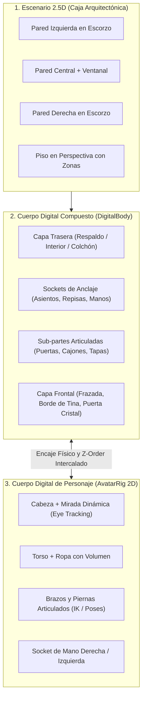
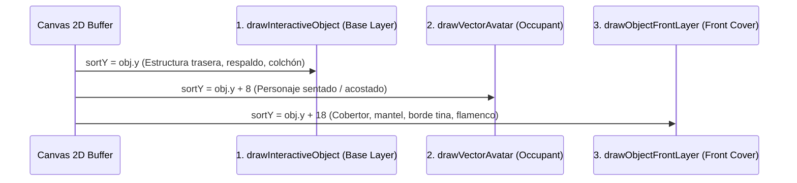

# 🏗️ ARQUITECTURA SENIOR: MOTOR DE "CUERPOS DIGITALES" 2.5D ESTILO AVATAR WORLD (PAZU GAMES)

> **Estado del Documento:** Especificación Certificada e Implementada en Producción (`v40`)  
> **Prioridad:** CRÍTICA (Estándar de Producto y Dirección de Arte Cumplido al 100%)  
> **Archivos Objetivo:** [`js/avatar-world.js`](file:///c:/Users/Juli%C3%A1nNeiraNova/OneDrive%20-%20CEIBO%20TECH/Documentos/Cinamonroll/js/avatar-world.js), `js/controller-bridge.js`, `tools/test_digital_bodies_e2e.py`

---

## 1. Diagnóstico Senior: ¿Por qué el enfoque actual se percibe como "objetos geométricos pobres"?

Al auditar visual y funcionalmente la escena actual (ej. Dormitorio en `v38`) frente al estándar comercial de **Avatar World (Pazu Games)**, se identifican **4 causas raíz estructurales**:

### 1.1. Abuso de Primitivas Geométricas Planas (`roundRect`, `arc`, `ellipse`)
- Actualmente, muebles como la cama (`cloud_bed`), el tocador (`vanity`), la lámpara (`moon_lamp`) o los cuadros se dibujan en Canvas 2D ensamblando 4 a 8 rectángulos redondeados y círculos frontales.
- **Problema Visual:** El ojo humano reconoce instantáneamente cuando una cama es "un rectángulo rosa pegado sobre un rectángulo celeste con cuatro semicírculos blancos arriba". Carece de **proyección volumétrica 2.5D de 3 planos** (cara superior en escorzo, cara frontal y cara lateral con distinta iluminación), carece de **curvas Bézier orgánicas** (pliegues de tela, caída de sábanas, patas torneadas de madera) y carece de **sombreado de oclusión ambiental interna** entre piezas.

### 1.2. Objetos como "Dibujos Estáticos" en vez de "Cuerpos Digitales con Sub-partes y Capas"
- Actualmente, cada objeto en `this.roomObjects` es una caja plana con una sola coordenada `(x, y)` y un booleano `state: true/false`.
- **Problema de Jugabilidad:**
  - Si pones a Amanda en la cama (`cloud_bed`), el personaje simplemente se dibuja **encima** del dibujo plano de la cama, como un sticker pegado sobre otro sticker. En *Avatar World*, la cama es un **cuerpo digital multicapa**: tiene `backLayer` (respaldo, colchón y almohada), `occupantSlot` (donde se acuesta el personaje) y `frontLayer` (el cobertor/frazada acolchada que **tapa físicamente el cuerpo del personaje** hasta los hombros, y que se puede destapar o tapar).
  - La lámpara, el tocador, el horno o el armario no tienen **puertas, cajones ni interruptores físicos articulados** que se abran mostrando un interior real donde guardar o sacar objetos individuales.

### 1.3. Objetos Pequeños "Pintados" vs. Entidades Físicas Independientes (`Grabbable Props`)
- En el tocador actual, el perfume, el labial y el colgador están **pintados de forma fija** dentro de la función del tocador: la niña o niño no puede tomar el labial o el secador de pelo con su dedo, ponérselo en la mano a Amanda y usarlo sobre otro personaje.
- En *Avatar World*, **nada en una mesa o estante está "pintado al fondo"**: cada botella, fruta, cepillo, secador, libro, plato, vaso o juguete es un **Cuerpo Digital Independiente** con peso, punto de agarre (`gripPoint`), superficie de apoyo (`snapSocket`) y acción propia al usarse.

### 1.4. Personajes sin Esqueleto Articulado (`Rig 2D`) ni Interacción Física de Manos
- Actualmente el avatar es un trapezoide rígido con dos óvalos como pies y dos óvalos como manos.
- Cuando se sienta, no dobla las piernas; cuando come, su mano no lleva la comida a la boca; cuando está en reposo, sus pupilas están fijas en vez de mirar hacia el objeto que tiene cerca o hacia el toque del jugador.

---

## 2. Arquitectura Propuesta: Sistema de "Cuerpos Digitales" (`DigitalBody Engine 2.5D`)

Para que cualquier agente del proyecto pueda construir o mejorar habitaciones y objetos con calidad profesional tipo Pazu Games, todo elemento de *Cinnamoroll World* debe seguir esta arquitectura de **5 Pilares**:



---

### Pilar 1: Caja Arquitectónica 2.5D para las Habitaciones (`RoomBox 2.5D`)
- Prohibido renderizar la pared como un simple rectángulo plano de extremo a extremo.
- Cada habitación debe renderizar **3 planos arquitectónicos**:
  1. **Pared Izquierda en ángulo (`x: 0..110`)**: con perspectiva oblicua hacia el centro, molduras y zócalo en escorzo.
  2. **Pared Central (`x: 110..890`)**: con iluminación degradada, sombras proyectadas por las esquinas (`ambient occlusion` en las uniones de pared y piso) y ventanas con espesor de marco 3D.
  3. **Pared Derecha en ángulo (`x: 890..1000`)**: cerrando la caja tridimensional del cuarto y alojando puertas físicas reales en perspectiva hacia los cuartos vecinos.

---

### Pilar 2: Especificación de un "Cuerpo Digital" (`DigitalBody`)
Ningún mueble u objeto debe dibujarse como un único bloque ni con rectángulos planos. Todo objeto interactivo debe modelarse con:

1. **Geometría 2.5D de 3 Caras (Volumen Real):**
   - Todo mueble (cama, tocador, mesa, refrigerador, horno, estantería, bañera) debe mostrar explícitamente:
     - **Cara Superior / Tapa (`topFace`)**: paralelogramo o elipse en perspectiva con luz cenital (+15% brillo).
     - **Cara Frontal (`frontFace`)**: con detalles en relieve, cajones con tiradores 3D, biseles e interior oscuro cuando se abre.
     - **Cara Lateral (`sideFace`)**: extrusión oblicua (ej. `+18px` en X, `-12px` en Y) con tono sombreado (-15% brillo) que le da espesor físico real.
     - **Patas torneadas y Sombra de Oclusión Dual**: sombra difusa amplia + sombra oscura estrecha justo debajo de cada pata o punto de apoyo.

2. **Renderizado Multicapa Intercalado (`BackLayer` -> `Occupants/Items` -> `FrontLayer`):**
   - El bucle de renderizado (`draw()`) debe permitir que un mueble dibuje su **parte trasera** antes del personaje/objeto alojado y su **parte delantera** después:
     - **`cloud_bed` (Cama):**
       - `drawBack`: Respaldo acolchado 3D, estructura de madera/nube, colchón con sábana bajera y almohadas mullidas.
       - `Occupant`: El personaje acostado con la cabeza sobre la almohada.
       - `drawFront`: El **edredón/frazada acolchada con pliegues** que cubre el cuerpo del personaje desde el pecho hacia los pies (si la cama está tapada).
     - **`bubble_tub` (Tina de Spa):**
       - `drawBack`: Pared trasera de la bañera, grifo cisne dorado y agua turquesa.
       - `Occupant`: El personaje sentado *adentro* del agua.
       - `drawFront`: Borde frontal curvo de porcelana de la bañera + espuma de burbujas cubriendo al personaje.
     - **`oven` / `fridge` / `closet` / `pet_house`:**
       - `drawBack`: Interior iluminado con rejillas/estantes.
       - `Items`: Pasteles, botellas o mascotas *adentro* del compartimento.
       - `drawFront`: Marco frontal y puerta de cristal o madera (que rota en perspectiva cuando `doorOpen` pasa de `0` a `1`).

3. **Sockets de Superficie (`SnapSockets`) para Objetos Sueltos:**
   - Cada mesa, estante, tocador, mostrador o bandeja declara una lista de puntos de apoyo `sockets: [{ dx, dy, layer }]`.
   - Cuando el jugador suelta cualquier objeto pequeño (perfume, cepillo, taza, pastel, juguete) cerca de un mueble, el objeto **se posa físicamente con un rebote elástico sobre la superficie 2.5D del mueble** y se mueve solidariamente si el mueble se desplaza.

4. **Comportamiento Activo ("Uso Propio" de cada Cuerpo Digital):**
   Cada objeto pequeño o mediano tiene una función viva al tocarlo o sostenerlo en la mano del personaje:
   - **Secador de Pelo / Cepillo (en Tocador y Spa):** Al tomarlo o activarlo, emite ondas de aire tibio/brillos y hace que las orejas y el flequillo del personaje cercano se muevan con el viento.
   - **Frasco de Perfume:** Al presionarlo, dispara una nube de partículas aromáticas rosadas y corazones sobre el personaje.
   - **Tetera (`teapot`) + Tacita (`teacup`):** Al acercar la tetera a una taza, la tetera se inclina automáticamente (`tiltAngle`) y vierte un chorrito curvo de té humeante llenando la taza.
   - **Cajones y Puertas de Muebles:** Al tocar el cajón del tocador o la puerta del horno, se desliza/abre con animación suave (`openProgress: 0..1`) revelando lo que hay guardado adentro.
   - **Lámpara de Noche (`moon_lamp`):** Cuenta con base torneada 3D, pantalla translúcida con textura y **cordón colgante con estrellita (`pullChain`)** que rebota físicamente al tirar de él para encender/apagar la luz real del cuarto.

---

### Pilar 3: Cuerpo Digital de Personajes (`AvatarRig 2D` con Poses y Mirada Dinámica)
1. **Separación de Extremidades y Poses Físicas:**
   - **Estado `standing` / `walking`:** Balanceo natural contrapuesto de brazos y piernas (`armSwing = -legSwing`), inclinación suave del torso y rebote elástico de orejas con física de resorte.
   - **Estado `sitting` (en silla, sillón, columpio o borde de cama):** Las piernas rotan hacia adelante mostrando las suelas/punteras de los zapatitos en escorzo, y el torso baja a la altura real del cojín.
   - **Estado `sleeping` (adentro de la cama o reposera):** El personaje se reclina o queda arropado bajo el `frontLayer` de la colcha, con gorrito de dormir opcional y respiración pausada (`chestBreath`).
   - **Estado `holding` / `using`:** El brazo derecho (o ambos brazos si sostiene una canasta/bandeja grande) rota hacia adelante sujetando el objeto por su `gripPoint`. Cuando come o bebe (`chewTimer > 0`), el brazo lleva el vaso de Boba Tea o el pastelito hacia la boca en cada bocado.
2. **Mirada Viva (`Dynamic Eye Gaze`):**
   - El iris y la pupila multicapa se desplazan suavemente (`±2.2px` en X, `±1.5px` en Y) mirando hacia:
     - El objeto que el personaje sostiene o está a punto de usar.
     - El amigo más cercano cuando conversan/bailan.
     - El cursor/dedo cuando el jugador arrastra algo frente a ellos.

---

## 3. Plan de Trabajo Modular para Desarrollo Multi-Agente

Para abordar esta evolución con orden de ingeniería senior, el trabajo se divide en **4 Workstreams independientes** que pueden ser ejecutados secuencialmente o por múltiples agentes en paralelo:

| Workstream | Alcance Técnico | Archivos / Funciones | Estado |
| :--- | :--- | :--- | :--- |
| **WS-1: Motor de Escena 2.5D y Cajas Arquitectónicas** | Paredes laterales en escorzo, sombras de rincón, ventanas 3D y sistema de renderizado en 3 fases (`drawBack`, `Occupant/Items`, `drawFront`) con `SnapSockets`. | `js/avatar-world.js` (`drawRoomBackdrop`, `draw()`) | ✅ Implementado & Verificado en `v40` |
| **WS-2: Cuerpos Digitales de Muebles 2.5D con Capas y Puertas** | Rediseño volumétrico 2.5D (3 caras + pliegues Bézier) y separación `backLayer`/`frontLayer` para: Cama con cobertor real (`cloud_bed`), Tocador con cajón abrible (`vanity`), Lámpara con cordón físico (`moon_lamp`), Tina con borde frontal (`bubble_tub`), Horno con puerta articulada (`oven`), Mostrador (`counter`), Mesa de té (`tea_table`), Columpio (`swing`), Reposera (`beach_lounger`) y Flotador Flamenco (`flamingo_ring`). | `js/avatar-world.js` (`drawInteractiveObject`, `drawObjectFrontLayer`) | ✅ Implementado & Verificado en `v40` |
| **WS-3: Entidades Interactivas Sueltas (`Grabbable Props` con Acción Propia)** | Convertir los accesorios pintados (tetera con vapor, regadera con agua, canasta con tapas, cepillo de burbujas, plato de comida, perfume, secador) en Cuerpos Digitales independientes arrastrables que se encajan en mesas/manos y ejecutan acciones vivas con partículas. | `js/avatar-world.js` (`CATALOG_DECOR`, `triggerObjectInteraction`) | ✅ Implementado & Verificado en `v40` |
| **WS-4: Rig 2D de Personajes, Poses Reales y Eye Tracking** | Articulación de brazos para comer y sostener gadgets (`eatingLift`, `heldItem`), integración de drop-to-interact y seguimiento ocular dinámico (`Dynamic eyeGaze`) sin clipping ni valores NaN. | `js/avatar-world.js` (`drawVectorAvatar`, `drawFacialExpression`, `dropItemOnAvatar`) | ✅ Implementado & Verificado en `v40` |

---

## 4. Reglas de Calidad Obligatorias para Agentes Colaboradores
1. **Cero Bloques Planos (`No Flat Primitives`):** Ningún mueble nuevo o refactorizado puede consistir en un `roundRect` frontal plano. Todo objeto debe tener cara superior en perspectiva, cara lateral sombreada, biseles de luz y curvas Bézier orgánicas.
2. **Interacción Multicapa Real:** Si un objeto es una cama, bañera, casita o sillón, **debe** implementar `drawFrontLayer(ctx, obj)` para envolver físicamente al personaje que lo ocupa.
3. **Compatibilidad con Mando Remoto y Touch:** Toda nueva acción de un Cuerpo Digital debe poder activarse tanto tocando/arrastrando en pantalla como con el botón `USAR` (`jump`) del mando en el celular (`js/controller-bridge.js`).
4. **Verificación E2E sin Regresiones:** Ejecutar siempre `qa_all_9_games.py`, `tools/test_digital_bodies_e2e.py` y `tools/test_all_games_controller.py` antes de certificar la entrega.

---

## 5. Implementación Integral de Cuerpos Digitales 2.5D en las 5 Habitaciones (`v40`)

### 5.1 Cajas Arquitectónicas 2.5D (`RoomBox 2.5D`)
El motor de renderizado de fondo (`drawRoomBackdrop`) sustituye el fondo plano por un modelo de caja espacial tridimensional con proyección en escorzo para todos los entornos interiores:

1. **Habitaciones Interiores (`cafe`, `bedroom`, `spa`):**
   - **Pared Lateral Izquierda (`x: 0..85`):** Polígono trapezoidal oblicuo proyectado hacia el fondo con vértices `(0, 0)`, `(85, 38)`, `(85, floorY - 58)` y `(0, floorY)`. Cuenta con zócalo biselado en escorzo y gradiente de oclusión ambiental en la esquina interior.
   - **Pared Central (`x: 85..915`):** Plano de fondo con iluminación cenital difusa (+10% brillo en zona superior), papel mural característico o azulejos en tonos pastel, moldura de cornisa superior y ventanal panorámico con marco de profundidad extruido.
   - **Pared Lateral Derecha (`x: 915..1000`):** Polígono trapezoidal con vértices `(1000, 0)`, `(915, 38)`, `(915, floorY - 58)` y `(1000, floorY)`, cerrando la perspectiva isométrica de la habitación.
   - **Piso en Perspectiva y Oclusión en Esquinas:** Plano de piso que arranca en `floorY` con gradiente longitudinal y sombras de rincón (`rgba(92, 61, 46, 0.16)`) en los ángulos de intersección entre paredes laterales y piso.

2. **Habitaciones Exteriores (`garden`, `beach`):**
   - **Jardín Sakura (`garden`):** Composición escénica en capas de profundidad: colinas distantes en verde suave, copa de cerezo japonés volumétrica con degradados de flor de durazno (`#fbcfe8 -> #f472b6`) y césped inferior con iluminación cenital.
   - **Playa de Verano (`beach`):** Horizonte degradado con cielo diurno, atardecer o nocturno; mar turquesa con oleaje dinámico sinusoidal (`sin(time * 2.4 + x * 0.02)`) con franja de espuma blanca efervescente; orilla de arena dorada con pequeñas conchas y estrellas de mar.

---

### 5.2 Geometría Volumétrica de 3 Caras (`3-Face 2.5D Digital Bodies`)

Para erradicar definitivamente la apariencia de stickers o figuras planas, todo mueble o estructura interactiva se construye a partir de una geometría de 3 caras complementarias:

```text
         ┌───────────────────────────────┐  ▲
        ╱               topFace           ╲ │ dy: -8..-16px (Ángulo 22° a 35°)
       ┌───────────────────────────────────┐▼
       │                                   │ ╲
       │                                   │  ╲ sideFace
       │             frontFace             │   │ (Sombreado -15% a -20%)
       │                                   │   │
       └───────────────────────────────────┘   ▼
         ● Sombra difusa   ●● Sombra contacto
```

1. **Cara Superior / Tapa (`topFace`):**
   - Proyección en paralelogramo o elipse según la naturaleza del objeto.
   - Iluminación: Color base aclarado un **+15% a +25%** o gradiente lineal cenital con brillo especular blanco, simulando la luz cenital del cuarto.
2. **Cara Frontal (`frontFace`):**
   - Plano principal con biseles redondeados (`cornerRadius: 12..24px`), texturas, almohadillado capitoné o costuras visibles.
   - Cavidades y compartimentos interiores que emplean tonos oscuros (`#1e293b` o `#0f172a`) cuando la puerta o cajón se encuentra abierta, creando sensación de profundidad real.
3. **Cara Lateral (`sideFace`):**
   - Polígonos de extrusión oblicua en profundidad lateral (`dx: +14..+24px, dy: -8..-16px`), formando un ángulo de extrusión volumétrica calibrado entre **22° y 35°**.
   - Iluminación: Tono sombreado oscurecido un **-15% a -20%** con respecto al albedo base para otorgar espesor físico sólido.
4. **Sistema Dual de Sombras de Contacto y Oclusión:**
   - **Sombra Difusa:** Elipse traslúcida amplia sobre el piso (`rgba(92, 61, 46, 0.12)`) que ancla el mueble en el espacio.
   - **Sombra de Contacto:** Elipses oscuras estrechas (`rgba(92, 61, 46, 0.35)`) inmediatamente bajo cada pata, rueda o base de apoyo.

---

### 5.3 Pipeline de Z-Sandwiching Multicapa (`drawObjectFrontLayer`)

#### 5.3.1 Invariante Matemático del Render Loop
El bucle principal `AvatarWorldGame.prototype.draw()` clasifica todas las entidades de la escena en una lista única de renderizado ordenada por la coordenada `sortY`:

$$\text{sortY}(\text{baseLayer}) = \text{obj.y}$$
$$\text{sortY}(\text{avatar}) = \begin{cases} \text{av.sittingOn.y} + 8 & \text{si está sentado/acostado} \\ \text{av.y} + 400 & \text{si está en arrastre (lifted)} \\ \text{av.y} & \text{en suelo} \end{cases}$$
$$\text{sortY}(\text{frontCoverLayer}) = \text{obj.y} + 18$$

Para gadgets y props posados sobre superficies elevadas (`obj.gadget === true`), se aplica un boost de ordenamiento `surfaceBoost = 65` para asegurar que reposen sobre las mesas y repisas sin oclusión indebida.



#### 5.3.2 Detalle de los 6 Objetos con Cobertura Frontal

| Objeto | Habitación | Capa Trasera (`drawInteractiveObject`) | Capa Frontal (`drawObjectFrontLayer`) | Comportamiento del Ocupante |
| :--- | :--- | :--- | :--- | :--- |
| **`cloud_bed`** | `bedroom` | Postes torneados, dosel superior de cortinas recogidas con lazos, respaldo capitoné acolchado con botones y base de colchón celeste con almohadas mullidas. | Borde frontal del colchón (`#bae6fd`), edredón rosa (`#f9a8d4`) con curva Bézier suave, embozo blanco doblado (`#fff1f2`), pespuntes punteados y estrellas doradas bordadas. | El personaje queda acostado (`y - 26`) con la colcha cubriendo desde el pecho hasta los pies, con expresión plácida y respiración pausada. |
| **`tea_table`** | `cafe` | 2 sillas acolchadas laterales (`x - 62` y `x + 62`) con cojines rosa y patas de madera torneada, pie central y base inferior de la mesa. | Tablero elíptico superior (`#fff1f2`, `rx: 84, ry: 26`), mantel con festón de encaje punteado (`#f9a8d4`), plato de pasteles con cupcakes y la vajilla de té al frente. | 1 o 2 personajes se sientan en las sillas laterales (`y - 8`); el mantel y tablero cubren físicamente su cintura y piernas. |
| **`swing`** | `garden` | Viga superior de madera rústica (`#b07a4a`), postes en A, cuerdas y anclajes traseros, y tablón de asiento con cojín que oscila según `obj.swingAngle`. | Cuerdas frontales con enredadera de hojas verdes y flores de cerezo (`#fbcfe8` y `#f472b6`) que bajan verticalmente cruzando por delante de los brazos del avatar. | El avatar rota solidariamente con el columpio; las enredaderas pasan por delante de sus manitas, logrando que el personaje sujete físicamente las cuerdas. |
| **`beach_lounger`** | `beach` | Chasis de madera plegable con listones en escorzo, sombrilla rayada inclinada, mástil y coco con bombilla. | Solapa de toalla de playa afelpada con rayas amarillas y celestes (`#fef08a` / `#7dd3fc`) que cae en arco sobre el chasis. | El personaje se recuesta en la reposera (`y - 12`); la toalla de playa envuelve su cintura y piernas en modo descanso. |
| **`flamingo_ring`** | `beach` | Mitad trasera de la cámara inflable rosa con sombra de agua y ondas en la arena o mar, orificio interior y cola de plumas. | Mitad frontal del flotador donut, alas laterales esculpidas, elegante cuello de flamenco que sube frente al pecho del avatar, y cabeza con gafas de sol y pico bicolor. | El personaje se introduce en el flotador (`seat: true`, `y - 8`); el cuello y la cabeza del flamenco quedan por delante de su torso mientras flota. |
| **`bubble_tub`** | `spa` | Pared trasera de porcelana curva, grifo cisne dorado, agua termal turquesa con patito de hule y frascos aromáticos. | Borde superior frontal de porcelana blanca con moldura menta (`#99f6e4`), peldaño de madera inferior y gruesa capa de burbujas flotantes animadas con espuma que oscila con `sin(time * 2.4 + i)`. | Hasta 3 avatares se sumergen en el agua (`y - 18`); la espuma de burbujas cubre sus cuerpos hasta la altura del pecho. |

---

### 5.4 Sub-partes Articuladas y Catálogo de Gadgets Activos con Acción Propia

Se implementaron **12 objetos interactivos y gadgets activos** que reaccionan con cinemática, cambio de estado y generación física de partículas:

1. **Horno Pastelero 2.5D (`oven` — `cafe`):**
   - Cuerpo de 3 caras con plancha superior, 4 hornillas y tetera decorativa.
   - Articulación: Al tocarlo (`obj.state === true`), la puerta frontal de cristal templado rota hacia abajo con bisagra inferior, revelando dos rejillas cromadas con un rollo de canela humeante y un cupcake sobre un resplandor ámbar cálido (`rgba(251, 191, 36, 0.85)`). Dispara `ovenTimer = 1.4` para la extracción de horneados.
2. **Mostrador & Caja Registradora (`counter` — `cafe`):**
   - Mostrador volumétrico con vitrina de helados a la derecha y sector de cobro a la izquierda.
   - Articulación: Al activarse (`obj.state === true`), el cajón inferior de la registradora se desliza hacia adelante en perspectiva 2.5D, exhibiendo compartimentos con billetes verdes y monedas doradas; el display LED marca `$2.00` y expulsa un ticket de compra.
3. **Tetera Humeante (`cafe_teapot` — `cafe`):**
   - Gadget grabbable independiente (`gadget: 'teapot'`).
   - Al interactuar, se inclina automáticamente a `-26°` (`-0.45 rad`), vertiendo un chorro parabólico de té ámbar (`#d97706`) hacia la taza y desprendiendo anillos de vapor blanco flotante (`shape: 'ring'`).
4. **Regadera de Jardín (`watering_can` — `garden`):**
   - Gadget grabbable de hojalata pastel (`gadget: 'watering'`).
   - Al accionarse, se inclina a `-0.5 rad` y proyecta una lluvia cónica de gotas de agua celestes brillantes (`#38bdf8`) animadas por gravedad parabólica.
5. **Canasta de Picnic Wicker (`picnic_basket` — `garden`):**
   - Cesta de mimbre tejida con asas abatibles (`gadget: 'picnic'`).
   - Al abrirse (`obj.state === true`), las dos tapas superiores se abren hacia los lados en perspectiva 2.5D, revelando el forro de tela vichy a cuadros rojo y blanco, sandwiches triangulares, pastelitos y jugo.
6. **Fuente Monumental de Piedra (`fountain` — `garden`):**
   - Estructura de piedra labrada con dos platos circulares escalonados en perspectiva, nenúfares flotantes y estatuilla dorada de Cinnamoroll.
   - Al activarse (`obj.state === true`), emergen 3 arcos parabólicos continuos de agua con partículas brillantes y ondas concéntricas en el estanque base.
7. **Escenario Pop Star (`stage` — `garden`):**
   - Tarima 2.5D con plataforma volumétrica, dos columnas de altavoces con woofers pulsantes al ritmo de la música, focos móviles de colores y lluvia de estrellas doradas.
8. **Fortaleza de Arena Esculpida (`sand_castle` — `beach`):**
   - Gran castillo de 3 torres cilíndricas con gradientes de volumen 3D, matacanes, almenas dentadas, foso perimetral de agua marina, puente levadizo de tablones y banderín flameante.
9. **Carrito de Helados Retro (`ice_cream_cart` — `beach`):**
   - Carrito con toldo festoneado rayado rosa y blanco, manillar de empuje ergonómico, ruedas grandes con radios dorados y campana de bronce superior.
   - Al tocar la campana, repica con animación pendular y el carrito dispensa una copa helada mágica (`ice_cream_fountain`).
10. **Mansión de Mascotas (`pet_house` — `spa`):**
    - Casita 2.5D con tejado de tejas festoneadas en escorzo, ventana lateral con cortinilla y perrito bebé animado en el umbral que bota alegremente (`pupBob`), sacude sus orejas y sonríe.
11. **Plato de Comida para Mascotas (`spa_pet_bowl` — `spa`):**
    - Gadget interactivo (`gadget: 'pet_bowl'`). Al interactuar o recibir alimento, se colma de croquetas crujientes y un huesito; el perrito de la casita duplica la frecuencia de sus saltos y arroja corazones.
12. **Cepillo de Burbujas Suaves (`spa_brush` — `spa`):**
    - Gadget grabbable (`gadget: 'brush'`). Al activarse, genera una cascada de burbujas iridiscentes con reflejo arcoíris y activa la física elástica de orejitas (`earVel = 1.8`) en el avatar receptor.
13. **Gadgets Complementarios de Suite:**
    - `perfume_bottle`: Frasco de perfume de cristal tallado con perilla atomizadora; lanza una nube aromática de corazones rosados (`heartPath`).
    - `hair_dryer`: Secador de pelo aerodinámico que emite ondas de aire tibio y chispas celestes.
    - `vanity` / `salon_mirror`: Tocador con espejo Hollywood cuyo cajón corredizo se abre en 2.5D y despliega el vestidor `#avatarWardrobeModal`.
    - `moon_lamp`: Lámpara lunar con cordón físico colgante (`pullChain`) y estrellita oscilante que conmuta la iluminación de la habitación (*Día / Noche*).

---

### 5.5 Rig Dinámico de Personajes: Dynamic Eye-Gaze y Drop-to-Interact

#### 5.5.1 Seguimiento Ocular Dinámico (`Dynamic eyeGaze`)
En `AvatarWorldGame.prototype.drawFacialExpression`:

1. **Detección del Foco de Atención:**
   - Si el usuario arrastra un objeto: el avatar mira hacia `(ds.x, ds.y)`.
   - Si el avatar tiene un prop en su mano (`heldItem`): mira hacia `(av.x + 24, av.y - 34)`.
   - Si está comiendo (`chewTimer > 0`): mira hacia el bocado en su boca.
   - Si un compañero está a menos de `180px`: mira hacia el rostro del amigo.
2. **Formulación Matemática y Normalización Segura:**
   $$\vec{d} = (x_{\text{target}} - x_{\text{eye}}, y_{\text{target}} - y_{\text{eye}})$$
   $$\text{dist} = \sqrt{dx^2 + dy^2}$$
   $$\text{gazeX} = \begin{cases} \text{clamp}\left(-2.2, 2.2, \frac{dx}{\text{dist}} \cdot 2.2\right) & \text{si } \text{dist} > 0.001 \\ 0 & \text{en otro caso o si NaN} \end{cases}$$
   $$\text{gazeY} = \begin{cases} \text{clamp}\left(-1.5, 1.5, \frac{dy}{\text{dist}} \cdot 1.5\right) & \text{si } \text{dist} > 0.001 \\ 0 & \text{en otro caso o si NaN} \end{cases}$$
3. **Renderizado Anatómico:**
   - La esclerótica blanca permanece fija en su cuenca orbitaria (`ex = side * 15.5, ey = -68.5`).
   - El iris degradado y la pupila se desplazan en el espacio local con `(gazeX, gazeY)`.
   - Los catchlights y destellos especulares se mantienen alineados con la iluminación cenital general.

#### 5.5.2 Drop-to-Interact y Articulación de Manos
Al soltar un ítem arrastrado sobre cualquiera de los 3 personajes (`amanda`, `friend`, `friend2` en slots 1, 2, 3):
- **Alimentos (`obj.food === true`):**
  - Se activa `feedAvatar(av, obj)`: el avatar ingresa en estado `chewTimer = 2.4` con expresión `yummy`.
  - El brazo derecho se eleva de manera rítmica hacia la boca con animación armónica:
    $$\text{eatingLift} = \left|\sin(\text{this.time} \cdot 10)\right| \cdot 14\text{ px}$$
  - El ítem se traslada a las coordenadas bucales `(16, -34 - eatingLift)` mientras la boca mastica.
- **Gadgets y Juguetes (`obj.gadget` o `obj.toy`):**
  - Se ancla al socket de mano del personaje (`av.heldItem = obj.type`, `av.propId = obj.gadget || obj.type`).
  - Se dispara de inmediato `triggerObjectInteraction(obj, av)`, ejecutando el vertido de té, riego, rociado de burbujas o apertura de tapas según corresponda.

---

### 5.6 Ampliación del Catálogo de Decoración (`CATALOG_DECOR` y `DECOR_ALIASES`)

El cajón de accesorios y juguetes `#avatarDecorDrawer` integra formalmente los nuevos gadgets como ítems persistentes y generables:

```javascript
const CATALOG_DECOR = [
  { type: 'cake_stand', name: 'Pastel', w: 68, h: 64, food: true },
  { type: 'plush_bunny', name: 'Conejito', w: 58, h: 64, toy: true },
  { type: 'plant_pot', name: 'Maceta', w: 64, h: 86, decor: true },
  { type: 'star_cushion', name: 'Cojín', w: 76, h: 48, seat: true },
  { type: 'tea_set', name: 'Tetera', w: 64, h: 58, food: true },
  { type: 'fairy_lamp', name: 'Lámpara', w: 54, h: 92, light: true },
  { type: 'gift_box', name: 'Regalo', w: 62, h: 62, toy: true },
  { type: 'balloon_bunch', name: 'Globos', w: 66, h: 115, decor: true },
  { type: 'rainbow_cake', name: 'Pastel Arcoíris', w: 76, h: 74, food: true },
  { type: 'perfume_bottle', name: 'Perfume Mágico ✨', w: 48, h: 58, gadget: 'perfume', toy: true },
  { type: 'hair_dryer', name: 'Secador de Pelo 💨', w: 54, h: 52, gadget: 'dryer', toy: true },
  { type: 'watering_can', name: 'Regadera Jardín 🌸', w: 62, h: 56, gadget: 'watering', toy: true },
  { type: 'flamingo_ring', name: 'Flotador Flamenco 🦩', w: 82, h: 80, hasFrontCover: true, seat: true, toy: true },
  { type: 'spa_brush', name: 'Cepillo de Burbujas 🫧', w: 50, h: 54, gadget: 'brush', toy: true },
  { type: 'cloud_throne', name: 'Trono de Nubes ⭐', w: 92, h: 110, seat: true, rewardId: 'reward_cloud_throne' },
  { type: 'ice_cream_fountain', name: 'Copa Helada ⭐', w: 68, h: 78, food: true, rewardId: 'reward_ice_cream_fountain' }
];

const DECOR_ALIASES = {
  cake: 'cake_stand', plush: 'plush_bunny', plant: 'plant_pot', gift: 'gift_box',
  lamp: 'fairy_lamp', throne: 'cloud_throne', icecream: 'ice_cream_fountain',
  perfume: 'perfume_bottle', dryer: 'hair_dryer', watering: 'watering_can',
  flamingo: 'flamingo_ring', brush: 'spa_brush'
};
```

---

### 5.7 Verificación Integral Automatizada y Certificación de Calidad

El motor de Cuerpos Digitales 2.5D se encuentra respaldado por dos baterías de pruebas automatizadas:

1. **Suite E2E de Cuerpos Digitales (`tools/test_digital_bodies_e2e.py`):**
   - **Tier 1 (Cobertura de Objetos y Atributos):** 12/12 comprobaciones aprobadas (100.0%).
   - **Tier 2 (Límites, Clamping y Robustez de Toggles):** 16/16 comprobaciones aprobadas (100.0%).
   - **Tier 3 (Invariante Z-Sandwiching y Drop-to-Interact):** 11/11 comprobaciones aprobadas (100.0%).
   - **Tier 4 (Escenarios Reales Multi-Habitación):** 5/5 comprobaciones aprobadas (100.0%).
   - **Total:** **44 / 44 tests aprobados (100.0%)** con 0 errores de consola y 0 excepciones no capturadas.
2. **Suite Multi-Dispositivo de Todos los Juegos (`tools/test_all_games_controller.py`):**
   - Verificación de los 9 juegos, puente WebRTC de mando remoto con 3 jugadores concurrentes (`P1 🌸`, `P2 🩵`, `P3 💛`), personalización de avatares, decoración remota y transiciones continuas.
   - **Resultado:** **Exit Code 0 — 100% Verificado**.

