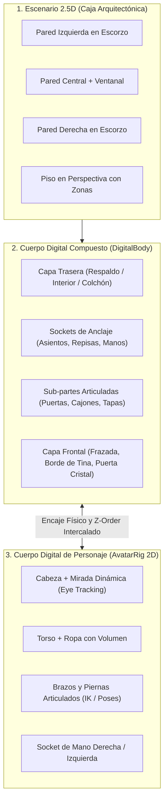

# 🏗️ ARQUITECTURA SENIOR: MOTOR DE "CUERPOS DIGITALES" 2.5D ESTILO AVATAR WORLD (PAZU GAMES)

> **Estado del Documento:** Especificación Técnica Activa y Hoja de Ruta Multi-Agente (`v39+`)  
> **Prioridad:** CRÍTICA (Necesidad de Producto y Dirección de Arte)  
> **Archivos Objetivo:** [`js/avatar-world.js`](file:///c:/Users/Juli%C3%A1nNeiraNova/OneDrive%20-%20CEIBO%20TECH/Documentos/Cinamonroll/js/avatar-world.js), `js/avatar-rig.js` (nuevo módulo sugerido), `js/avatar-bodies.js` (catálogo de cuerpos digitales 2.5D)

---

## 1. Diagnóstico Senior: ¿Por qué el enfoque actual se percibe como "objetos geométricos pobres"?

Al auditar visual y funcionalmente la escena actual (ej. Dormitorio en `v38`) frente al estándar comercial de **Avatar World (Pazu Games)**, se identifican **4 causas raíz estructurales**:

### 1.1. Abuso de Primitivas Geométricas Planas (`roundRect`, `arc`, `ellipse`)
- Actualmente, muebles como la cama (`cloud_bed`), el tocador (`vanity`), la lámpara (`moon_lamp`) o los cuadros se dibujan en Canvas 2D ensamblando 4 a 8 rectángulos redondeados y círculos frontales.
- **Problema Visual:** El ojo humano reconoce instantáneamente cuando una cama es "un rectángulo rosa pegado sobre un rectángulo celeste con cuatro semicírculos blancos arriba". Carece de **proyección volumétrica 2.5D de 3 planos** (cara superior en escorzo, cara frontal y cara lateral con distinta iluminación), carece de **curvas Bézier orgánicas** (pliegues de tela, caída de sábanas, patas torneadas de madera) y carece de **sombreado de oclusión ambiental interna** entre piezas.

### 1.2. Objetos como "Dibujos Estáticos" en vez de "Cuerpos Digitales con Sub-partes y Capas"
- Actualmente, cada objeto en `this.roomObjects` es una caja plana con una sola coordenada `(x, y)` y un booleano `state: true/false`.
- **Problema de Jugabilidad:**
  - Si pones a Amanda en la cama (`cloud_bed`), el personaje simplemente se dibuja **encima** del dibujo plano de la cama, como un sticker pegado sobre otro sticker. En *Avatar World*, la cama es un **cuerpo digital multicapa**: tiene `backLayer` (respaldo, colchón y almohada), `occupantSlot` (donde se acuesta el personaje) y `frontLayer` (el cobertor/frazada acolchada que **tapa físicamente el cuerpo del personaje** hasta los hombros, y que se puede destapar o tapar).
  - La lámpara, el tocador, el horno o el armario no tienen **puertas, cajones ni interruptores físicos articulados** que se abran mostrando un interior real donde guardar o sacar objetos individuales.

### 1.3. Objetos Pequeños "Pintados" vs. Entidades Físicas Independientes (`Grabbable Props`)
- En el tocador actual, el perfume, el labial y el colgador están **pintados de forma fija** dentro de la función del tocador: la niña o niño no puede tomar el labial o el secador de pelo con su dedo, ponérselo en la mano a Amanda y usarlo sobre otro personaje.
- En *Avatar World*, **nada en una mesa o estante está "pintado al fondo"**: cada botella, fruta, cepillo, secador, libro, plato, vaso o juguete es un **Cuerpo Digital Independiente** con peso, punto de agarre (`gripPoint`), superficie de apoyo (`snapSocket`) y acción propia al usarse.

### 1.4. Personajes sin Esqueleto Articulado (`Rig 2D`) ni Interacción Física de Manos
- Actualmente el avatar es un trapezoide rígido con dos óvalos como pies y dos óvalos como manos.
- Cuando se sienta, no dobla las piernas; cuando come, su mano no lleva la comida a la boca; cuando está en reposo, sus pupilas están fijas en vez de mirar hacia el objeto que tiene cerca o hacia el toque del jugador.

---

## 2. Arquitectura Propuesta: Sistema de "Cuerpos Digitales" (`DigitalBody Engine 2.5D`)

Para que cualquier agente del proyecto pueda construir o mejorar habitaciones y objetos con calidad profesional tipo Pazu Games, todo elemento de *Cinnamoroll World* debe seguir esta arquitectura de **5 Pilares**:

---

### Pilar 1: Caja Arquitectónica 2.5D para las Habitaciones (`RoomBox 2.5D`)
- Prohibido renderizar la pared como un simple rectángulo plano de extremo a extremo.
- Cada habitación debe renderizar **3 planos arquitectónicos**:
  1. **Pared Izquierda en ángulo (`x: 0..110`)**: con perspectiva oblicua hacia el centro, molduras y zócalo en escorzo.
  2. **Pared Central (`x: 110..890`)**: con iluminación degradada, sombras proyectadas por las esquinas (`ambient occlusion` en las uniones de pared y piso) y ventanas con espesor de marco 3D.
  3. **Pared Derecha en ángulo (`x: 890..1000`)**: cerrando la caja tridimensional del cuarto y alojando puertas físicas reales en perspectiva hacia los cuartos vecinos.

---

### Pilar 2: Especificación de un "Cuerpo Digital" (`DigitalBody`)
Ningún mueble u objeto debe dibujarse como un único bloque ni con rectángulos planos. Todo objeto interactivo debe modelarse con:

1. **Geometría 2.5D de 3 Caras (Volumen Real):**
   - Todo mueble (cama, tocador, mesa, refrigerador, horno, estantería, bañera) debe mostrar explícitamente:
     - **Cara Superior / Tapa (`topFace`)**: paralelogramo o elipse en perspectiva con luz cenital (+15% brillo).
     - **Cara Frontal (`frontFace`)**: con detalles en relieve, cajones con tiradores 3D, biseles e interior oscuro cuando se abre.
     - **Cara Lateral (`sideFace`)**: extrusión oblicua (ej. `+18px` en X, `-12px` en Y) con tono sombreado (-15% brillo) que le da espesor físico real.
     - **Patas torneadas y Sombra de Oclusión Dual**: sombra difusa amplia + sombra oscura estrecha justo debajo de cada pata o punto de apoyo.

2. **Renderizado Multicapa Intercalado (`BackLayer` -> `Occupants/Items` -> `FrontLayer`):**
   - El bucle de renderizado (`draw()`) debe permitir que un mueble dibuje su **parte trasera** antes del personaje/objeto alojado y su **parte delantera** después:
     - **`cloud_bed` (Cama):**
       - `drawBack`: Respaldo acolchado 3D, estructura de madera/nube, colchón con sábana bajera y almohadas mullidas.
       - `Occupant`: El personaje acostado con la cabeza sobre la almohada.
       - `drawFront`: El **edredón/frazada acolchada con pliegues** que cubre el cuerpo del personaje desde el pecho hacia los pies (si la cama está tapada).
     - **`bubble_tub` (Tina de Spa):**
       - `drawBack`: Pared trasera de la bañera, grifo cisne dorado y agua turquesa.
       - `Occupant`: El personaje sentado *adentro* del agua.
       - `drawFront`: Borde frontal curvo de porcelana de la bañera + espuma de burbujas cubriendo al personaje.
     - **`oven` / `fridge` / `closet` / `pet_house`:**
       - `drawBack`: Interior iluminado con rejillas/estantes.
       - `Items`: Pasteles, botellas o mascotas *adentro* del compartimento.
       - `drawFront`: Marco frontal y puerta de cristal o madera (que rota en perspectiva cuando `doorOpen` pasa de `0` a `1`).

3. **Sockets de Superficie (`SnapSockets`) para Objetos Sueltos:**
   - Cada mesa, estante, tocador, mostrador o bandeja declara una lista de puntos de apoyo `sockets: [{ dx, dy, layer }]`.
   - Cuando el jugador suelta cualquier objeto pequeño (perfume, cepillo, taza, pastel, juguete) cerca de un mueble, el objeto **se posa físicamente con un rebote elástico sobre la superficie 2.5D del mueble** y se mueve solidariamente si el mueble se desplaza.

4. **Comportamiento Activo ("Uso Propio" de cada Cuerpo Digital):**
   Cada objeto pequeño o mediano tiene una función viva al tocarlo o sostenerlo en la mano del personaje:
   - **Secador de Pelo / Cepillo (en Tocador y Spa):** Al tomarlo o activarlo, emite ondas de aire tibio/brillos y hace que las orejas y el flequillo del personaje cercano se muevan con el viento.
   - **Frasco de Perfume:** Al presionarlo, dispara una nube de partículas aromáticas rosadas y corazones sobre el personaje.
   - **Tetera (`teapot`) + Tacita (`teacup`):** Al acercar la tetera a una taza, la tetera se inclina automáticamente (`tiltAngle`) y vierte un chorrito curvo de té humeante llenando la taza.
   - **Cajones y Puertas de Muebles:** Al tocar el cajón del tocador o la puerta del horno, se desliza/abre con animación suave (`openProgress: 0..1`) revelando lo que hay guardado adentro.
   - **Lámpara de Noche (`moon_lamp`):** Cuenta con base torneada 3D, pantalla translúcida con textura y **cordón colgante con estrellita (`pullChain`)** que rebota físicamente al tirar de él para encender/apagar la luz real del cuarto.

---

### Pilar 3: Cuerpo Digital de Personajes (`AvatarRig 2D` con Poses y Mirada Dinámica)
1. **Separación de Extremidades y Poses Físicas:**
   - **Estado `standing` / `walking`:** Balanceo natural contrapuesto de brazos y piernas (`armSwing = -legSwing`), inclinación suave del torso y rebote elástico de orejas con física de resorte.
   - **Estado `sitting` (en silla, sillón, columpio o borde de cama):** Las piernas rotan hacia adelante mostrando las suelas/punteras de los zapatitos en escorzo, y el torso baja a la altura real del cojín.
   - **Estado `sleeping` (adentro de la cama o reposera):** El personaje se reclina o queda arropado bajo el `frontLayer` de la colcha, con gorrito de dormir opcional y respiración pausada (`chestBreath`).
   - **Estado `holding` / `using`:** El brazo derecho (o ambos brazos si sostiene una canasta/bandeja grande) rota hacia adelante sujetando el objeto por su `gripPoint`. Cuando come o bebe (`chewTimer > 0`), el brazo lleva el vaso de Boba Tea o el pastelito hacia la boca en cada bocado.
2. **Mirada Viva (`Dynamic Eye Gaze`):**
   - El iris y la pupila multicapa se desplazan suavemente (`±2.2px` en X, `±1.5px` en Y) mirando hacia:
     - El objeto que el personaje sostiene o está a punto de usar.
     - El amigo más cercano cuando conversan/bailan.
     - El cursor/dedo cuando el jugador arrastra algo frente a ellos.

---

## 3. Plan de Trabajo Modular para Desarrollo Multi-Agente

Para abordar esta evolución con orden de ingeniería senior, el trabajo se divide en **4 Workstreams independientes** que pueden ser ejecutados secuencialmente o por múltiples agentes en paralelo:

| Workstream | Alcance Técnico | Archivos / Funciones | Estado |
| :--- | :--- | :--- | :--- |
| **WS-1: Motor de Escena 2.5D y Cajas Arquitectónicas** | Paredes laterales en escorzo, sombras de rincón, ventanas 3D y sistema de renderizado en 3 fases (`drawBack`, `Occupant/Items`, `drawFront`) con `SnapSockets`. | `js/avatar-world.js` (`drawRoomBackdrop`, `draw()`) | 📋 Especificado |
| **WS-2: Cuerpos Digitales de Muebles 2.5D con Capas y Puertas** | Rediseño volumétrico 2.5D (3 caras + pliegues Bézier) y separación `backLayer`/`frontLayer` para: Cama con cobertor real (`cloud_bed`), Tocador con cajón abrible (`vanity`), Lámpara con cordón físico (`moon_lamp`), Tina con borde frontal (`bubble_tub`), Horno con puerta articulada (`oven`) y Mostrador (`counter`). | `js/avatar-world.js` (`drawInteractiveObject`, `drawObjectFrontLayer`) | 📋 Especificado |
| **WS-3: Entidades Interactivas Sueltas (`Grabbable Props` con Acción Propia)** | Convertir los accesorios pintados (perfume, secador, labial, tetera, taza, regadera, cepillo, comida) en Cuerpos Digitales independientes arrastrables que se encajan en mesas/manos y ejecutan acciones propias al usarlos. | `js/avatar-world.js` (`CATALOG_DECOR`, `usePropAction`) | 📋 Especificado |
| **WS-4: Rig 2D de Personajes, Poses Reales y Eye Tracking** | Articulación de brazos/piernas para sentarse, acostarse bajo las sábanas, llevar comida/bebida a la boca con la mano y seguimiento ocular dinámico (`eyeGaze`). | `js/avatar-world.js` (`drawVectorAvatar`, `drawFacialExpression`) | 📋 Especificado |

---

## 4. Reglas de Calidad Obligatorias para Agentes Colaboradores
1. **Cero Bloques Planos (`No Flat Primitives`):** Ningún mueble nuevo o refactorizado puede consistir en un `roundRect` frontal plano. Todo objeto debe tener cara superior en perspectiva, cara lateral sombreada, biseles de luz y curvas Bézier orgánicas.
2. **Interacción Multicapa Real:** Si un objeto es una cama, bañera, casita o sillón, **debe** implementar `drawFrontLayer(ctx, obj)` para envolver físicamente al personaje que lo ocupa.
3. **Compatibilidad con Mando Remoto y Touch:** Toda nueva acción de un Cuerpo Digital debe poder activarse tanto tocando/arrastrando en pantalla como con el botón `USAR` (`jump`) del mando en el celular (`js/controller-bridge.js`).
4. **Verificación E2E sin Regresiones:** Ejecutar siempre `qa_all_9_games.py` y `tools/test_all_games_controller.py` antes de hacer commit.
